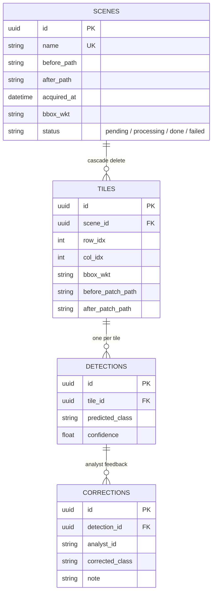

# Terra Watch

Land-use change detection from multispectral satellite imagery using ResNet-50 + Random Forest ensemble, with FastAPI backend, PostgreSQL persistence, and a React analyst dashboard.

## Overview

- **ML Pipeline**: ResNet-50 (frozen early layers) + Random Forest late fusion on 2048-d embeddings; 5 land-use change classes
- **FastAPI Backend**: `/scenes` (ingest), `/detections` (results), `/corrections` (analyst feedback)
- **PostgreSQL**: Scenes, tiles, detections, corrections with UUID PKs and cascade deletes
- **React Dashboard**: Scene list, detection tile grid, label correction form
- **Docker Compose**: Postgres + backend service

## Tech Stack

Python 3.11 · PyTorch · scikit-learn · rasterio · FastAPI · PostgreSQL · SQLAlchemy · React 18 · Vite

## Quickstart

```bash
# Start database
docker compose up -d db

# Backend
cd backend && pip install -r requirements.txt
uvicorn app.main:app --reload --port 8000

# ML training
cd .. && pip install -r ml/requirements.txt
python -m ml.src.train --data_csv ml/data/sample.csv --epochs 20

# Frontend
cd frontend && npm install && npm run dev
```

## Architecture

```mermaid
flowchart TB
    subgraph training["Offline training — ml/"]
        csv["ChangeDetectionDataset<br/>reads a CSV of patch pairs"]
        tf["transforms: resize 224,<br/>flips and rotation for train"]
        net["ResNet-50 IMAGENET1K_V2<br/>conv1 replaced with 9 input channels<br/>(3 bands x before / after / diff)<br/>everything below layer3 frozen<br/>head: 2048 &#8594; 512 &#8594; 5 classes"]
        opt["Adam on trainable params,<br/>cosine LR, cross-entropy,<br/>macro F1 on the val split"]
        ckpt["best_model.pt saved on best F1"]
        emb["build_embedding_extractor<br/>strips the head to expose<br/>2048-d embeddings"]
    end

    subgraph api["FastAPI backend"]
        post["POST /scenes<br/>multipart: name, acquired_at,<br/>before_file, after_file"]
        bg["BackgroundTasks &#8594; run_inference_for_scene"]
        tile["tile_scene<br/>rasterio opens both GeoTIFFs,<br/>walks a 224 px grid"]
        pred["per-tile prediction<br/>currently a placeholder:<br/>random class + confidence"]
        load["load_model<br/>lazy torch + joblib load,<br/>warns and falls back if unavailable"]
        det["GET /detections<br/>filter by scene and class"]
        corr["POST /corrections<br/>analyst label + note"]
        hl["GET /health<br/>SELECT 1 against Postgres"]
    end

    db[("PostgreSQL<br/>scenes &#8594; tiles &#8594; detections &#8594; corrections")]

    subgraph ui["React + Vite dashboard"]
        sl["SceneList"]
        di["DetectionInspector"]
        dash["Dashboard"]
    end

    csv --> tf --> net --> opt --> ckpt
    net --> emb
    ckpt -.->|"intended to be loaded by"| load
    post --> db
    post --> bg --> tile --> pred --> db
    load -.-> pred
    db --> det
    db --> corr
    det --> dash
    corr --> di
    dash --> sl
    dash --> di
```



The scene status moves `pending` &#8594; `processing` &#8594; `done`, or `failed` if the background task raises. Note that the serving path in `app/services/inference.py` still emits placeholder predictions &mdash; the trained checkpoint is loaded by `load_model` but is not yet wired into `run_inference_for_scene`.



## Classes

| ID | Label |
|----|-------|
| 0 | no_change |
| 1 | deforestation |
| 2 | urban_expansion |
| 3 | water_shift |
| 4 | agriculture |

## Tests

```bash
# Backend tests (pytest, async)
cd backend && pytest tests/ -v
```

The `backend/tests/` directory is currently a placeholder; a representative end-to-end check
against a running stack:

```bash
# Ingest a scene pair
curl -X POST http://localhost:8000/scenes -F "before=@tile_t0.tif" -F "after=@tile_t1.tif"

# Fetch detections and corrections for the scene
curl http://localhost:8000/detections?scene_id=<id>
curl -X POST http://localhost:8000/corrections \
  -H "Content-Type: application/json" \
  -d '{"detection_id":"<id>","corrected_class":1}'
```

## Evaluation

This is a 5-class classification problem (`no_change`, `deforestation`, `urban_expansion`,
`water_shift`, `agriculture`). Training (`ml/src/train.py`) computes:

- **Macro F1** on the held-out validation split via `sklearn.metrics.f1_score(..., average="macro")`
  after each epoch; the best checkpoint is retained.
- **Per-epoch loss** (cross-entropy) for both train and val splits.

Recommended additional offline metrics to compute on the test split:

| Metric | How to compute |
|--------|----------------|
| Per-class precision / recall / F1 | `sklearn.metrics.classification_report` over predictions vs. labels |
| Confusion matrix | `sklearn.metrics.confusion_matrix`, normalized rows |
| Macro and weighted ROC-AUC | `roc_auc_score(y_true, y_score, multi_class="ovr")` on RF soft-vote probabilities |
| Calibration | reliability diagram of predicted confidence vs. empirical accuracy (binned) |

The data split is defined by `ml/data/sample.csv` (`split` column: `train`/`val`/`test`). Run
`python -m ml.src.train --data_csv ml/data/sample.csv --epochs 20` to reproduce the headline
macro-F1 number printed at the end of training.
